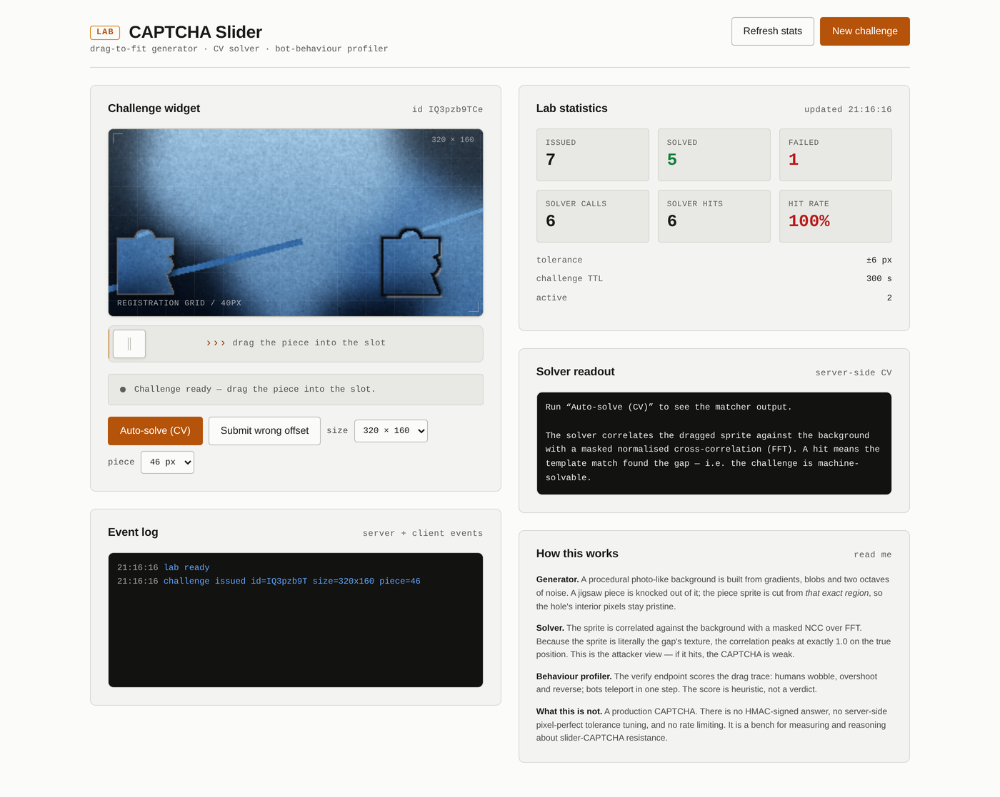
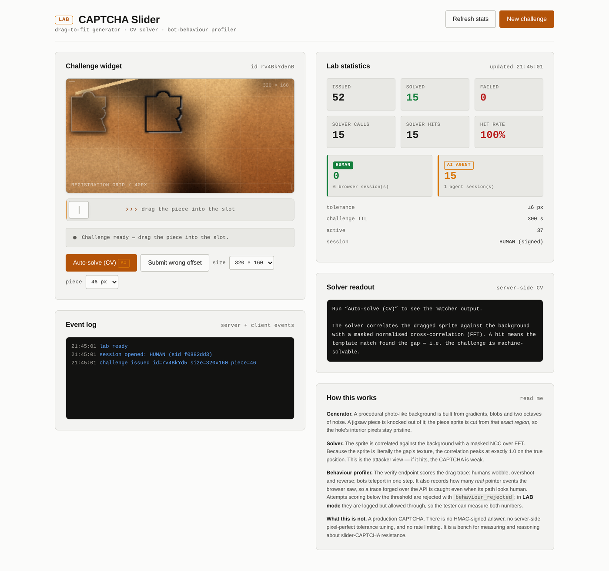

# Challenge Captcha Bot

> **A CAPTCHA is only as strong as its weakest attacker.**
> This repo builds the attacker — and the test bench that proves it works.

[ES](README.md) · [EN](README.en.md)



Automated CAPTCHA solving bot with **four local attackers** (slider, OCR text,
multi-select grid, single image), a **human-like movement engine** for pointer
traces, an HTTP client for endpoints that expose their challenge as JSON, a
**real browser** mode (Playwright) for canvas widgets, and the **test bench**
that measures all of it with numbers instead of opinions.

Everything runs **locally**. No cloud OCR, no API keys, no target-specific
training: the attacker has never seen the site's font.

> ⚖️ **Authorized use only.** This tool exists for security auditing: measuring
> whether *your* CAPTCHA holds up, or a client's under a signed contract. Using
> it for spam, mass account creation or fraud is out of scope and illegal in
> most jurisdictions. See [License and use](#license-and-use).

---

## What's in here

| Component | What it does |
|---|---|
| `bot/solvers.py` | The 4 attackers: slider (3 strategies), text (RapidOCR), grid (Hu moments), image (k-means + shapes) |
| `bot/gapdetect.py` | Gap detection by local contrast — the strategy that needs no sprite |
| `bot/behavior.py` | Human trace engine: Fitts's law, easing, tremor, overshoot |
| `bot/client.py` | HTTP client for JSON-exposed challenges, with an audit trail |
| `bot/browser.py` | Real-browser mode (Playwright/Chromium): solves and clicks like a person |
| `bot/cli.py` | Unified CLI: `image` · `api` · `browser` · `bench` · `serve` |
| `app/` | The CAPTCHA generator + lab server (FastAPI) with human/AI attribution |
| `bench.py` | Multi-type bench: exact rate, per-unit rate, cost, sweeps |

---

## Measured numbers

Run with `python3 bench.py --runs 30` (fixed seed `20261101`, 30 challenges per
family, local CPU, no GPU):

| Family | Challenge | Exact | Per unit | Cost | Attempts to pass |
|---|---|---|---|---|---|
| **slider** | drag the piece into the gap | **100%** | — | ~120 ms | **1.0** |
| **text** | "type the characters" (4–6) | **87%** | 91% per character | ~2.1 s | **1.2** |
| **grid** | "select all images with X" (3×3) | **87%** | 96% per cell | **5 ms** | **1.2** |
| **image** | "click the image with X" | 33% | 33% | 8 ms | 3.0 |

An honest read of the table:

- **slider**: 40/40 exact, **0 px error**. Finding the gap was never the hard
  part; the position was trivial from the start.
- **text**: breaks in ~1.2 attempts. The cost is OCR inference (~2 s), not
  engineering. A retry loop clears it in under 3 seconds.
- **grid**: same result at 5 ms. Here the cost is the *arithmetic*, not the
  model — which is why the two numbers look alike: the attacker is cheap, the
  multi-select is not.
- **image**: 33%. The bottleneck is **not** computer vision, it is
  *segmentation*. That's a useful finding: it points at where the hard work is.

### The multi-select arithmetic

The result that holds the bench up: the attacker keeps its per-cell accuracy
(~93%) while **full**-challenge success collapses.

| Target cells | Exact | Per cell | Attempts |
|---|---|---|---|
| 1 | 87% | 90% | 1.2 |
| 2 | 87% | 93% | 1.2 |
| 3 | 77% | 93% | 1.3 |
| 4 | 67% | 93% | 1.5 |
| 5 | 63% | 93% | 1.6 |
| 6 | 67% | 94% | 1.5 |

**A classifier with 93% per-cell accuracy only solves the full challenge
63–67% of the time.** With multi-select every error is paid for twice: a false
positive, *plus* the requirement that every cell be right.

That's the auditing lesson a client buys: **better classifiers do not scale.**
A model at 99% per cell still leaves 6% global error on a 6-cell grid, and that
6% multiplies by however many attempts an attacker is willing to make (free, if
a failure costs nothing). What actually protects you is **cost per attempt**,
telemetry and the behavioural gate — not model accuracy.

### Calibration matters (distortion sweep)

A distortion nobody ships in production produces numbers that mean nothing:

| Distortion | Exact | Per char | Attempts | Read |
|---|---|---|---|---|
| 0.00 | 83% | 89% | 1.2 | No distortion |
| 0.15 | 87% | 93% | 1.2 | Light noise |
| **0.30** | **87%** | **91%** | **1.2** | **Production range** |
| 0.45 | 77% | 83% | 1.3 | Aggressive |
| 0.60 | 57% | 81% | 1.8 | Very aggressive |
| 0.80 | 7% | 33% | 15 | Extreme — breaks the OCR |
| 1.00 | 10% | 18% | 10 | Extreme |

Up to ~0.45 the challenge is still decorative (one retry clears it); the real
cliff sits between 0.45 and 0.6; and above 0.8 the OCR breaks because wave
distortion destroys the horizontal lines the OCR needs to segment — not
because the attacker got better, but because the challenge stopped being
legible to **humans too**.

> **Distortion is not security.** A challenge a human can barely read and a bot
> cannot only protects against the bot that hasn't learned OCR yet. This bench's
> first version defaulted to `distortion=1.0` and published a 13% success rate.
> That was a *false* number: it described a CAPTCHA nobody would deploy.

### The uncomfortable result

The bench doesn't only measure whether the attacker wins. It measures **whether
the server knows who solved it**. And the verdict is that most of the defence
is decorative:

| Attack | Result | Why |
|---|---|---|
| `no_mouse` | ✅ solves | Posts the coordinates over the API, no real pointer event |
| `api_only` | ✅ solves | Attacks the endpoint directly |
| `teleport` | ✅ solves | Jumps to the right position with no trajectory |
| `humanish` | ✅ solves | Behaviour indistinguishable from a person |
| `drag` | ❌ blocked | Real pointer trajectory |

In production mode (behavioural gate active): **12/15 automated attacks
blocked**, and the 3 that pass are `humanish` — which is the correct outcome,
because an attack indistinguishable from a person *should not* be blocked on
shape alone.

And attribution: **15/15 solutions attributed to `AI AGENT`, 0 to `HUMAN`**, with
HMAC-SHA256-signed tokens where the type sits **inside the signature** (an agent
cannot relabel its own token as human).



> **A CAPTCHA without server-side attestation is a decorated form.**
> This repo includes the reason why that's true, measured.

### The payload that gives itself away

There's a finding faster than any computer vision, and the bot implements it as
the `geometry` strategy:

When a site cuts the piece **out of the gap** and publishes the sprite's origin
on the canvas (`sprite.origin_x/origin_y`), the gap's position travels **inside
the client payload itself**. The attacker doesn't need to look at the image: it
reads a number.

Measured against the lab: **10/10 challenges solved with 0 px error and not a
single computer-vision operation**. The bot's most expensive step — loading
the image — isn't even needed.

This isn't a flaw in the lab's generator: it's **the real pattern of a bad
implementation**, which is why it's measured and documented rather than hidden.
The lesson for a client is direct: *the client must not know the answer*. If
your endpoint publishes the gap's position, you have published the answer.

---

## Quick start

```bash
git clone https://github.com/santilpz28/Challenge-captcha.git
cd Challenge-captcha
python3 -m venv .venv && source .venv/bin/activate
pip install -r requirements.txt

# Real OCR (for the text family)
python3 -c "import rapidocr_onnxruntime" 2>/dev/null || pip install rapidocr-onnxruntime

# Real browser (for browser mode)
playwright install chromium
```

### Using the bot

```bash
# 1) Solve a CAPTCHA image from disk
python3 -m bot.cli image --family text --input captcha.png
python3 -m bot.cli image --family grid --input grid.png --target bus
python3 -m bot.cli image --family slider --input board.png --piece piece.png

# 2) Solve an endpoint that exposes its challenge as JSON
python3 -m bot.cli api --url https://site.tld --path /api/captcha \
    --family text --out report.json

# 3) Attack a real page with a real browser
python3 -m bot.cli browser --url https://site.tld/login \
    --family slider --image-selector '#board' --piece-selector '#piece' \
    --submit-selector '#verify' --screenshot out/attack.png

# 4) Reproduce the README numbers
python3 -m bot.cli bench --runs 30 --json out/bench.json

# 5) Run the lab (generator + UI + widget)
python3 -m bot.cli serve --port 8099   # → http://127.0.0.1:8099
```

`api` mode **does not submit** unless you pass `--submit` (it's a write
operation, and the CLI won't do it on its own). The report includes the full
**audit trail**: every request, every response, every latency.

### As a library

```python
from bot.solvers import get_solver

solver = get_solver("text")
result = solver.solve_image(open("captcha.png", "rb").read())
print(result.answer, result.confidence, result.duration_ms)
```

---

## How it works inside

### Slider solver (`app/solver.py` + `bot/gapdetect.py`)

Three strategies, because real sites differ:

| Strategy | How it works | When it wins |
|---|---|---|
| **geometry** | Reads the gap position straight out of the payload (`sprite.origin_x/y`) | When the site cuts the piece from the gap and publishes its origin. 0 px error, no computer vision |
| **template** | **Masked** normalised cross-correlation over FFT | When the sprite carries the pristine texture of the gap. 40/40 exact, 0 px, ~120 ms |
| **contrast** | The gap is a region darker than its surroundings: subtract a heavily blurred copy, threshold, and find compact square-ish blobs | When the site decorates the piece or repaints the gap's interior (breaking the correlation) |

`--strategy auto` tries `geometry` → `template` → `contrast` and keeps the first
reliable one. `bot/gapdetect.py` implements the third: classical, cheap (one
25-pixel window convolution + connected components) and **not needing the
sprite at all**.

> **The sprite and the solver's template are two different images.** The sprite
> the user sees carries a keyline and drop shadow; the solver receives a
> **pristine** crop of the same region. Mixing them dropped accuracy from 40/40
> to 14/40.

### Behaviour engine (`bot/behavior.py`)

The hard part of bypassing a modern CAPTCHA isn't reading it — it's *behaving*
like a person while you do. Sites look at the movement between pointer events,
not just the final answer.

The trace generator produces:

- **Fitts's law timing**: `T = a + b·log₂(1 + d/w)` — time depends on distance
  and target size, like a real person,
- **easing**: soft start and braking, peak speed mid-flight,
- **lateral arc**: people rarely travel in a straight line,
- **low-amplitude tremor**,
- **overshoot and correction** on short moves: people reach past and fix it.

```python
from bot.behavior import human_trace, motion_features

trace = human_trace(40, 300, 214, 300)
print(motion_features(trace))
# {'points': 47, 'duration_s': 0.42, 'efficiency': 0.94,
#  'mean_speed_px_s': 452.1, 'direction_changes': 3, ...}
```

`motion_features` is bidirectional: it checks that a synthesised trace looks
human *and* shows what a real human's trace looks like so you can imitate it.

### Clients

- **`bot/client.py`** — speaks JSON. `fetch_challenge()` pulls the image(s) out
  of the payload (raw base64 or `data:` URL), `submit()` **requires**
  `submit=True` so it never writes by accident, and `audit_trail()` returns the
  whole exchange for pasting into an audit report.
- **`bot/browser.py`** — behaves like a person: opens the page with Chromium,
  locates the image, solves it, **replays the trace** with step-by-step
  `page.mouse.move()`, then clicks or types the answer.

### Lab generator (`app/render.py`)

1. **Procedural background** — gradients + colour blobs + 2 octaves of noise +
   smoothstep contrast + saturation. No stock photos: every challenge is
   different and depends on no network.
2. **Jigsaw shape** — a rectangle with a **tab** on top and a **notch** on the right.
3. **The gap keeps the original texture** — that's what makes the challenge
   *solvable*: the solver has something to correlate against. A gap with
   invented texture would make the challenge unsolvable (and therefore useless).
4. **The piece is cut exactly from the gap area** → it carries the texture that
   must fit.
5. **Halo and keyline only *outside* the shape** (dilate − shape). Any pixel
   painted inside the shape corrupts the texture.

### Sessions and attribution (`app/auth.py`)

Session tokens are **HMAC-SHA256 signed** and the type (`human` / `ai_agent`)
lives **inside the signature**: an agent cannot relabel its token as human,
because the server rejects the altered signature.

Canonical format: `lab_<kind>.<payload_b64>.<sig_b64>` → `lab_human.…` /
`lab_ai_agent.…`. 1 h TTL.

> **The type is inside the signature, not in the payload.** If it were a plain
> field (`{"kind": "human"}`), an agent could relabel it without touching the
> signature. That's the difference between *labelling* and *attesting*: only the
> second survives a hostile actor.

---

## Lab API (optional)

The lab server exposes what you need to build your own bench.

### `GET /api/session?kind=human|ai_agent`

```jsonc
{
  "token": "lab_human.…",
  "session": {"kind": "human", "label": "HUMAN", "sid": "44ea8b8c…",
              "issued_at": 1793569070.4, "expires_at": 1793572670.4},
  "expires_in": 3600
}
```

### `GET /api/challenge?width=320&height=160&piece_size=46`

```jsonc
{
  "challenge_id": "…",
  "background": "data:image/png;base64,…",
  "piece":      "data:image/png;base64,…",
  "width": 320, "height": 160, "piece_size": 46,
  "sprite": {"w": 69, "h": 69, "opaque_x": 8, "opaque_y": 8,
             "opaque_w": 47, "opaque_h": 54},
  "piece_rest": {"x": 8,  "y": 45},
  "travel":    {"x": 143, "y": 0},
  "shape_centre": {"x": 174, "y": 81},
  "session": {"kind": "human", "label": "HUMAN", "sid": "44ea8b8c…"},
  "expires_in": 300
}
```

> **The gap never travels in the payload.** The ground truth stays on the server.

### `POST /api/verify`

```jsonc
// request
{
  "challenge_id": "…",
  "x": 174, "y": 81,
  "trace": [{"x": 12, "y": 300, "t": 0}, …],
  "duration_ms": 940,
  "pointer_events": 41
}
// response
{
  "ok": true,
  "distance_px": 0.5,
  "tolerance_px": 6,
  "solved_by": "ai_agent",
  "solved_by_label": "AI AGENT",
  "session_sid": "44ea8b8c…",
  "behaviour": {"wobble_ratio": 1.08, "path_len": 214.3, "samples": 41,
                "duration_ms": 940.0, "direction_changes": 3,
                "pointer_events": 41, "human_score": 1.0}
}
```

A challenge is **single-use**: it is discarded once solved (replay → 404).

If the position is right but the behavioural score falls below the threshold:
`{"ok": false, "reason": "behaviour_rejected", "behaviour": {...}}`.

### `POST /api/solve` · `POST /api/agent/solve`

The computer-vision solver against the challenge. **It returns the answer** —
deliberately accessible, because the lab's purpose is to measure whether the
challenge is breakable, not to hide it. It always marks the solve as
`ai_agent`.

### `GET /api/stats` · `GET /api/health`

```jsonc
{
  "issued": 44, "solved": 17,
  "solved_human": 1, "solved_ai_agent": 11, "solved_unknown": 5,
  "by_actor": {"human": 1, "ai_agent": 11, "unknown": 5},
  "sessions_human": 7, "sessions_ai_agent": 4,
  "solver_calls": 23, "solver_hits": 23, "solver_hit_rate": 1.0,
  "would_block": 12, "blocked": 0
}
```

---

## Structure

```
Challenge-captcha/
├── bot/
│   ├── __init__.py
│   ├── cli.py          # unified CLI (image · api · browser · bench · serve)
│   ├── solvers.py      # the 4 attackers + registry
│   ├── gapdetect.py    # gap detection by local contrast
│   ├── behavior.py     # human traces (Fitts, easing, tremor, overshoot)
│   ├── client.py       # JSON HTTP client + audit trail
│   └── browser.py      # real-browser mode (Playwright)
├── app/
│   ├── tokens.py       # palette, typography, spacing, canvas constants
│   ├── auth.py         # signed session tokens (human vs ai_agent)
│   ├── render.py       # procedural generator + Pillow compositor
│   ├── solver.py       # masked NCC over FFT
│   ├── server.py       # FastAPI + store + behaviour scoring
│   └── families/       # multi-type bench
│       ├── base.py            # Family contract + image utilities
│       ├── harness.py         # multi-family runner + metrics
│       ├── text_family.py     # family A — OCR (RapidOCR)
│       ├── grid_family.py     # family C — multi-select grid (Hu moments)
│       ├── image_family.py    # family B — single image (k-means + shapes)
│       └── clip_classifier.py # optional CLIP attacker (ONNX, on demand)
├── bench.py            # bench runner: sweep, scaling, JSON
├── static/             # the widget (HTML/CSS/JS, no framework)
├── tests/
│   ├── test_bot_unit.py    # 23 tests: trace engine, solvers, detector
│   ├── test_integration.py # the bot attacks the lab for real (12 checks)
│   ├── test_e2e.py         # 40 assertions for the lab (standalone script)
│   └── test_bot.py         # 5 attack strategies with Playwright
└── out/                # captures and reports (gitignored)
```

---

## What this tool does NOT defeat (read before you sell it)

Technical honesty is this repo's asset. These are the things it **does not**
do:

1. **It is not attestation.** `pointer_events` is reported by the client → it is
   forgeable. A synthesised human trace is kinematically plausible, but it is
   still a synthesised trace. Against **WebAuthn**, **Turnstile**, **hCaptcha**
   or **reCAPTCHA Enterprise** with real attestation, this is useless: those
   challenges authenticate the environment, not the answer.
2. **No WAF bypass, no IP rotation, no DNS resolution, no browser
   fingerprinting.** If blocking happens before the CAPTCHA, this bot doesn't
   touch it.
3. **It doesn't scale to large multi-select.** The grid arithmetic is brutal:
   93% per cell → 63–67% full-challenge success on 3×3. And `api` mode **does
   not** retry on its own: the retry loop belongs to whoever integrates this,
   and that loop is where cost-per-attempt (and server telemetry) decides.
4. **No native support for third-party CAPTCHA flows.** `api` mode speaks a
   configurable JSON dialect; if the site uses a session-bound token flow, adapt
   `client.py`.
5. **The bench images are synthetic.** Shapes drawn with a deliberately
   compressed palette so the attacker can't separate classes by colour. A real
   grid of photographs is **harder**, not easier.
6. **The bench attackers are classical, not modern.** The numbers are a *floor*.
   With CLIP or a VLM, the grid figures would go up.
7. **Distortion is calibrated against documented practice**, not against one
   specific site. If you have a real deployment, measure against it.

---

## Implementation notes (the ones that cost blood)

**The token separator: a one-line bug that split everything in half.** The token
was emitted as `lab_<kind>_<payload>.<sig>` and parsed with
`body.split("_", 1)`. Since the type itself contains an underscore (`ai_agent`),
the split cut the type in half: `ai_agent` → `ai`. The result was that **no
token ever validated**. But — and this is the interesting part — the flow still
*looked* like it worked: the server replied `kind: unknown` and nobody looked
because everything that mattered was already fine. A badly parsed token doesn't
break the system; **it degrades it in silence until it distinguishes nothing**,
which is the exact opposite of what it promises.

The rule: *a classifier that doesn't classify is worse than no classifier*,
because people trust the number. That's why the tests assert the exact
round-trip of the type, not just that the token "looks valid".

**One single source of truth for geometry.** `piece_rest` + `travel` +
`sprite.opaque_*` describe the shape's position; the client derives the centre
it submits from there. When client and server used different references (the
centre of the square body vs. the centre of the opaque shape), the error was a
constant **20 px** — the tell-tale of a structural misalignment, not an
arithmetic bug.

**`paste` with a mask REPLACES the alpha channel.** Painting a tint with
`paste(im, box, mask)` destroys the tint's alpha and leaves an opaque square.
You have to composite with `alpha_composite`. This bug showed up as "the sprite
is a black square" and cost two iterations.

**A `pointermove` before `pointerdown` is not a drag.** The trace came out empty
and the widget answered "drag the piece". Fix: seed the trace on `pointerdown`
and add the release point on `pointerup`.

**Measure, don't assume.** The first version of the gate scored the trace but
**never blocked**: the `human_score` was computed and ignored. The tester report
caught it — "15/15 attacks successful" with the same numbers as before the gate
was added. The missing metric wasn't the score, it was the **effective bypass
rate**: how many attacks actually defeat the CAPTCHA.

**The gap's contrast has to be measured, not assumed.** Measured over 12 seeds,
the luminance contrast between gap and surroundings was 0.6–4.2 in half the
cases: the gap was invisible except for a 1 px keyline. The fix (thicker keyline
+ specular rim + deeper inner shadow) raised the outline contrast to 26–134 in
11 of 12 seeds **without touching the interior texture**, which is what the
solver correlates.

**A gap must read as a gap, but its interior cannot change.** That tension is
the heart of the challenge: darken the interior and the solver loses the
texture and stops solving; don't, and the human can't see where to fit. The
solution is to move all the visual signal **outward** from the shape (keyline,
projected shadow, specular rim) and leave the interior byte-identical to the
background.

**Discriminate by provenance, not by shape.** The decisive gate signal wasn't
the trace score but the **real pointer events** the browser saw. Without it, a
forged API trace with human shape passed at 0.55; with it, it drops to 0.05 and
gets blocked. The same trace *with* pointer events is accepted → the gate
discriminates by provenance.

---

## License and use

MIT — see [`LICENSE`](LICENSE).

**Authorized use only.** This tool is for security auditing: measuring whether
*your* CAPTCHA holds up, or a client's under a signed audit contract. Using it
for spam, mass account creation, unauthorized scraping or fraud is illegal in
most jurisdictions (including DMCA §7 and §12, eComputer Directive 5(2) in the
EU, and LO 1/2015 arts. 156/229 in Spain). Do not send solved CAPTCHAs to third
parties, do not repackage it as a service, and do not point it at targets you
have not been authorised to test in writing.

For production, use a real CAPTCHA: **Cloudflare Turnstile**, **hCaptcha** or
**reCAPTCHA Enterprise** give you the attestation this repo cannot.

---

<sub>Built by <a href="https://github.com/santilpz28">santilpz28</a> ·
Chain-Cortex · smart contract audits and Web 2.5 security architecture.</sub>
