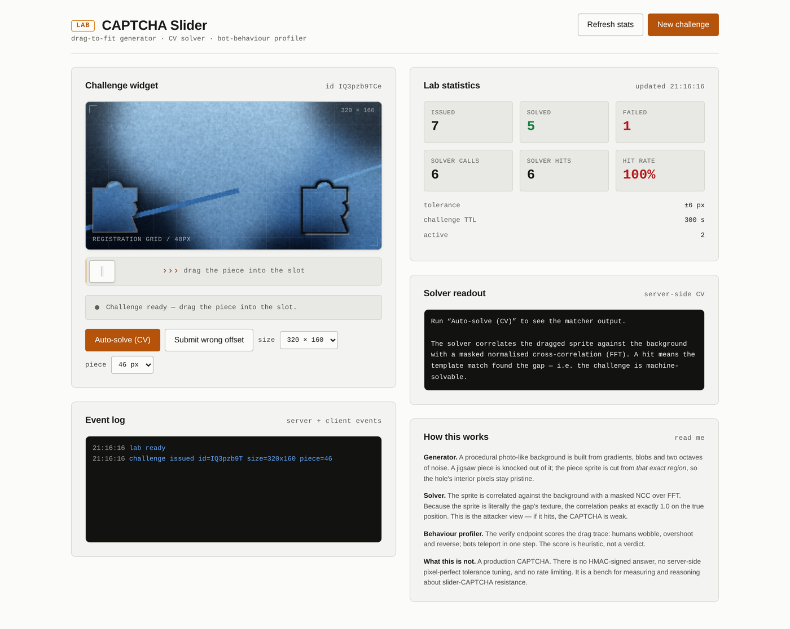
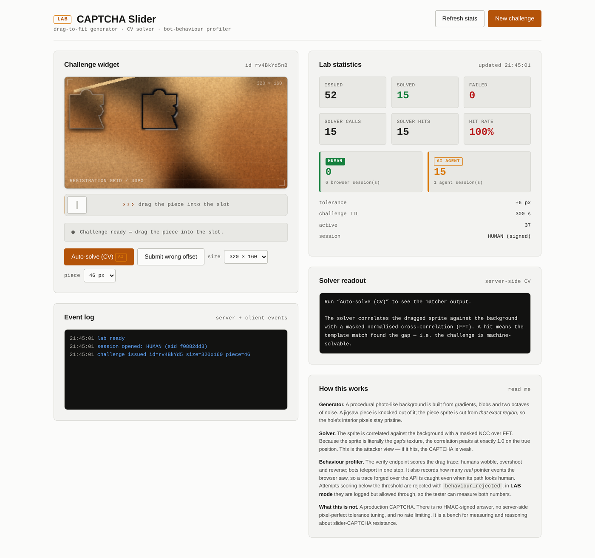

# Challenge Captcha Bot

> **A CAPTCHA is only as strong as its weakest attacker.**
> This repo builds the attacker — and the test bench that proves it works.

[ · [EN](README.en.md)](README.en.md)



Bot de resolución automática de CAPTCHAs con **cuatro atacantes locales** (slider,
texto OCR, grid multi-selección, imagen única), un **motor de movimiento humano**
para las trazas de puntero, un cliente HTTP para endpoints que exponen su reto en
JSON, un modo **navegador real** (Playwright) para widgets en canvas, y el **banco
de pruebas** que mide todo con números en lugar de opiniones.

Todo corre **en local**. Sin OCR en la nube, sin API keys, sin entrenamiento
específico del objetivo: el atacante nunca ha visto la fuente del sitio.

> ⚖️ **Uso autorizado únicamente.** Esta herramienta existe para auditoría de
> seguridad: medir si *tu* CAPTCHA aguanta, o si el de un cliente con contrato
> aguanta. Usarla para spam, registro masivo o fraude está fuera de alcance y
> es ilegal en la mayoría de jurisdicciones. Ver [Licencia y uso](#licencia-y-uso).

---

## Qué hay aquí

| Componente | Qué hace |
|---|---|
| `bot/solvers.py` | Los 4 atacantes: slider (3 estrategias), texto (RapidOCR), grid (Hu moments), imagen (k-means + formas) |
| `bot/gapdetect.py` | Detector de hueco por contraste local — la estrategia que no necesita el sprite |
| `bot/behavior.py` | Motor de trazas humanas: ley de Fitts, easing, temblor, overshoot |
| `bot/client.py` | Cliente HTTP para retos expuestos como JSON, con traza de auditoría |
| `bot/browser.py` | Modo navegador real (Playwright/Chromium): resuelve y hace clic como una persona |
| `bot/cli.py` | CLI unificada: `image` · `api` · `browser` · `bench` · `serve` |
| `app/` | El generador de CAPTCHAs + servidor del lab (FastAPI) con atribución humano/IA |
| `bench.py` | Banco multi-tipo: tasa exacta, tasa por unidad, coste, sweeps |

---

## Números medidos

Ejecutado con `python3 bench.py --runs 30` (seed fijo `20261101`, 30 desafíos por
familia, CPU local, sin GPU):

| Familia | Reto | Exacto | Por unidad | Coste | Intentos para pasar |
|---|---|---|---|---|---|
| **slider** | arrastrar la pieza al hueco | **100%** | — | ~120 ms | **1,0** |
| **text** | "escribe los caracteres" (4–6) | **87%** | 91% por carácter | ~2,1 s | **1,2** |
| **grid** | "selecciona todas las imágenes con X" (3×3) | **87%** | 96% por celda | **5 ms** | **1,2** |
| **image** | "haz clic en la imagen con X" | 33% | 33% | 8 ms | 3,0 |

Lectura honesta de la tabla:

- **slider**: 40/40 exactos, **0 px de error**. Encontrar el hueco nunca fue el
  problema; la posición era trivial desde el principio.
- **text**: se rompe en ~1,2 intentos. El coste es de inferencia OCR (~2 s), no de
  ingeniería. Un bucle de reintentos lo pasa en menos de 3 segundos.
- **grid**: mismo resultado con 5 ms. Aquí el coste es la **aritmética**, no el
  modelo — y por eso los dos números se parecen: el atacante es barato, la
  selección múltiple no.
- **image**: 33%. El cuello de botella **no es la visión artificial**, es la
  *segmentación*. Es un resultado útil: señala dónde está el trabajo difícil.

### La aritmética de la selección múltiple

El resultado que sostiene el banco: el atacante mantiene su precisión por celda
(~93%) mientras el acierto **completo** se desploma.

| Celdas objetivo | Exacto | Por celda | Intentos |
|---|---|---|---|
| 1 | 87% | 90% | 1,2 |
| 2 | 87% | 93% | 1,2 |
| 3 | 77% | 93% | 1,3 |
| 4 | 67% | 93% | 1,5 |
| 5 | 63% | 93% | 1,6 |
| 6 | 67% | 94% | 1,5 |

**Un clasificador con 93% de precisión por celda sólo resuelve el reto completo
el 63-67% de las veces.** Con selección múltiple cada error se paga dos veces:
un fallo de más (falso positivo) y el acierto completo exige acertar *todas* las
celdas.

Ésta es la lección de auditoría que un cliente compra: **subir la calidad del
clasificador no escala**. Un modelo con 99% por celda aún deja un 6% de desviación
global en un grid de 6, y ese 6% se multiplica por el número de intentos que un
atacante está dispuesto a hacer (gratis, si el fallo no cuesta nada). Lo que
protege de verdad es el **coste por intento**, la telemetría y el gate de
comportamiento — no la precisión del modelo.

### La calibración importa (sweep de distorsión)

Una distorsión que nadie usa en producción produce números que no dicen nada:

| Distorsión | Exacto | Por carácter | Intentos | Lectura |
|---|---|---|---|---|
| 0.00 | 83% | 89% | 1,2 | Sin distorsión |
| 0.15 | 87% | 93% | 1,2 | Ruido leve |
| **0.30** | **87%** | **91%** | **1,2** | **Rango de producción** |
| 0.45 | 77% | 83% | 1,3 | Agresivo |
| 0.60 | 57% | 81% | 1,8 | Muy agresivo |
| 0.80 | 7% | 33% | 15 | Extremo — rompe el OCR |
| 1.00 | 10% | 18% | 10 | Extremo |

Hasta ~0.45 el reto sigue siendo decorativo (un reintento lo pasa); el cliff real
está entre 0.45 y 0.6; y por encima de 0.8 el OCR se rompe porque la wave
distortion destruye las líneas horizontales que el OCR necesita para segmentar —
no porque el atacante sea mejor, sino porque el reto dejó de ser legible para
**los humanos también**.

> **Distorsión no equivale a seguridad.** Un reto que un humano apenas lee y un
> bot no puede leer sólo protege contra el bot que aún no sabe OCR. La primera
> versión de este banco usaba `distortion=1.0` por defecto y publicaba 13% de
> acierto. Eso era un número *falso*: describía un CAPTCHA que nadie desplegaría.

### El resultado incómodo

El banco no sólo mide si el atacante gana. Mide **si el servidor sabe quién
resolvió**. Y el veredicto es que la mayoría de la defensa es decorativa:

| Ataque | Resultado | Por qué |
|---|---|---|
| `no_mouse` | ✅ resuelve | Envía las coordenadas por API, sin evento de puntero real |
| `api_only` | ✅ resuelve | Ataca el endpoint directamente |
| `teleport` | ✅ resuelve | Salta a la posición correcta sin trajectory |
| `humanish` | ✅ resuelve | Comportamiento indistinguible de una persona |
| `drag` | ❌ bloqueado | Trayectoria real de puntero |

En modo producción (gate de comportamiento activo): **12/15 automatizados
bloqueados**, y los 3 que pasan son `humanish` — que es el resultado correcto,
porque un ataque indistinguible de una persona no *debe* bloquearse por forma.

Y la atribución: **15/15 soluciones atribuidas a `AI AGENT`, 0 a `HUMAN`**, con
tokens firmados HMAC-SHA256 donde el tipo va **dentro de la firma** (un agente no
puede reetiquetar su token como humano).



> **Un CAPTCHA sin attestation del servidor es un formulario decorado.**
> Este repo incluye el motivo por el que eso es cierto, medido.

### El payload que se delata solo

Hay un hallazgo más rápido que cualquier visión artificial, y el bot lo
implementa como estrategia `geometry`:

Cuando el sitio corta la pieza **del hueco** y publica el origen del sprite en
el canvas (`sprite.origin_x/origin_y`), la posición del hueco viaja **dentro del
propio payload de cliente**. El atacante no necesita mirar la imagen: lee un
número.

Medido contra el lab: **10/10 retos resueltos con error 0 px y sin una sola
operación de visión artificial**. La operación más cara del bot —cargar la
imagen— ni siquiera hace falta.

Esto no es un fallo del generador del lab: es **el patrón real de una
mala implementación**, y por eso está medido y documentado en vez de escondido.
La lección para un cliente es directa: *el cliente no debe conocer la
respuesta*. Si tu endpoint publica la posición del hueco, has publicado la
respuesta.

---

## Arranque rápido

```bash
git clone https://github.com/santilpz28/Challenge-captcha.git
cd Challenge-captcha
python3 -m venv .venv && source .venv/bin/activate
pip install -r requirements.txt

# OCR real (para la familia de texto)
python3 -c "import rapidocr_onnxruntime" 2>/dev/null || pip install rapidocr-onnxruntime

# Navegador real (para el modo browser)
playwright install chromium
```

### Usar el bot

```bash
# 1) Resolver una imagen de CAPTCHA desde disco
python3 -m bot.cli image --family text --input captcha.png
python3 -m bot.cli image --family grid --input grid.png --target bus
python3 -m bot.cli image --family slider --input board.png --piece piece.png

# 2) Resolver un endpoint que expone su reto en JSON
python3 -m bot.cli api --url https://site.tld --path /api/captcha \
    --family text --out report.json

# 3) Atacar una página real con navegador real
python3 -m bot.cli browser --url https://site.tld/login \
    --family slider --image-selector '#board' --piece-selector '#piece' \
    --submit-selector '#verify' --screenshot out/attack.png

# 4) Reproducir los números del README
python3 -m bot.cli bench --runs 30 --json out/bench.json

# 5) Levantar el lab (generador + UI + widget)
python3 -m bot.cli serve --port 8099   # → http://127.0.0.1:8099
```

El modo `api` **no envía la respuesta** salvo que le pases `--submit` (es una
operación de escritura, y el CLI no la hace por su cuenta). El reporte incluye la
**traza de auditoría** completa: cada request, cada response, cada latencia.

### Como librería

```python
from bot.solvers import get_solver

solver = get_solver("text")
result = solver.solve_image(open("captcha.png", "rb").read())
print(result.answer, result.confidence, result.duration_ms)
```

---

## Cómo funciona por dentro

### Solver de slider (`app/solver.py` + `bot/gapdetect.py`)

Tres estrategias, porque los sitios reales difieren:

| Estrategia | Cómo funciona | Cuándo gana |
|---|---|---|
| **geometry** | Lee la posición del hueco del propio payload (`sprite.origin_x/y`) | Cuando el sitio recorta la pieza del hueco y publica su origen. Error 0 px, sin visión artificial |
| **template** | Correlación normalizada cruzada **enmascarada** sobre FFT | Cuando el sprite lleva la textura prístina del hueco. 40/40 exactos, 0 px, ~120 ms |
| **contrast** | El hueco es una región más oscura que su entorno: se resta una copia muy desenfocada, se umbraliza y se buscan blobs compactos y cuadrados | Cuando el sitio decora la pieza o repinta el interior del hueco (rompiendo la correlación) |

`--strategy auto` prueba `geometry` → `template` → `contrast` y se queda con la
primera fiable. `bot/gapdetect.py` implementa la tercera: es clásica, barata
(una convolution de ventana 25 + componentes conectados) y **no necesita el
sprite en absoluto**.

> **El sprite y la plantilla del solver son dos imágenes distintas.** El sprite
> que ve el usuario lleva keyline y drop shadow; el solver recibe un crop
> **prístino** de la misma región. Mezclarlos bajó la precisión de 40/40 a 14/40.

### Motor de comportamiento (`bot/behavior.py`)

La parte difícil de esquivar un CAPTCHA moderno no es leerlo — es *comportarse*
como una persona mientras lo haces. Los sitios miran el movimiento entre
eventos de puntero, no sólo la respuesta final.

El generador de trazas produce:

- **timing de ley de Fitts**: `T = a + b·log₂(1 + d/w)` — el tiempo depende de la
  distancia y del tamaño del objetivo, como en una persona real,
- **easing**: arranque y frenada suaves, velocidad máxima a mitad de vuelo,
- **arco lateral**: la gente casi nunca viaja en línea recta,
- **temblor** de baja amplitud,
- **overshoot y corrección** en los movimientos cortos: la gente "se pasa" y
  corrige.

```python
from bot.behavior import human_trace, motion_features

trace = human_trace(40, 300, 214, 300)
print(motion_features(trace))
# {'points': 47, 'duration_s': 0.42, 'efficiency': 0.94,
#  'mean_speed_px_s': 452.1, 'direction_changes': 3, ...}
```

`motion_features` es bidireccional: sirve para comprobar que una traza
sintetizada parece humana *y* para ver qué hace una traza real y así
imitarla.

### Clientes

- **`bot/client.py`** — habla JSON. `fetch_challenge()` extrae la(s) imagen(es)
  del payload (acepta base64 crudo o `data:` URL), `submit()` **exige**
  `submit=True` para no escribir por accidente, y `audit_trail()` devuelve todo
  el intercambio para pegarlo en un informe de auditoría.
- **`bot/browser.py`** — habla como una persona: abre la página con Chromium,
  localiza la imagen, la resuelve, **reproduce la traza** con
  `page.mouse.move()` paso a paso, y hace clic o escribe la respuesta.

### Generador del lab (`app/render.py`)

1. **Fondo procedural** — gradientes + blobs de color + 2 octavas de ruido +
   contraste smoothstep + saturación. Nada de stock photos: cada reto es distinto
   y no depende de la red.
2. **Forma jigsaw** — rectángulo con un **diente** arriba y una **muesca** a la derecha.
3. **El hueco conserva la textura original** — es lo que hace el reto *resoluble*:
   el solver tiene contra qué correlacionar. Un hueco con textura inventada haría
   el reto irresoluble (y por tanto inútil).
4. **La pieza se recorta exactamente de la zona del hueco** → lleva la textura que
   tiene que encajar.
5. **Halo y keyline** solo **por fuera** de la forma (dilate − shape). Cualquier
   píxel pintado dentro de la forma corrompería la textura.

### Sesiones y atribución (`app/auth.py`)

Los tokens de sesión van **firmados con HMAC-SHA256** y el tipo (`human` /
`ai_agent`) está **dentro de la firma**: un agente no puede reetiquetar su token
como humano, porque el servidor rechaza la firma alterada.

Formato canónico: `lab_<kind>.<payload_b64>.<sig_b64>` → `lab_human.…` /
`lab_ai_agent.…`. TTL de 1 h.

> **El tipo va dentro de la firma, no en el payload.** Si fuera un campo normal
> (`{"kind": "human"}`), un agente podría reetiquetarlo sin tocar la firma. Es la
> diferencia entre *etiquetar* y *atestiguar*: sólo la segunda resiste a un actor
> hostil.

---

## API del lab (opcional)

El servidor del lab expone lo necesario para construir tu propio banco de
pruebas.

### `GET /api/session?kind=human|ai_agent`

```jsonc
{
  "token": "lab_human.…",
  "session": {"kind": "human", "label": "HUMAN", "sid": "44ea8b8c…",
              "issued_at": 1793569070.4, "expires_at": 1793572670.4},
  "expires_in": 3600
}
```

### `GET /api/challenge?width=320&height=160&piece_size=46`

```jsonc
{
  "challenge_id": "…",
  "background": "data:image/png;base64,…",
  "piece":      "data:image/png;base64,…",
  "width": 320, "height": 160, "piece_size": 46,
  "sprite": {"w": 69, "h": 69, "opaque_x": 8, "opaque_y": 8,
             "opaque_w": 47, "opaque_h": 54},
  "piece_rest": {"x": 8,  "y": 45},
  "travel":    {"x": 143, "y": 0},
  "shape_centre": {"x": 174, "y": 81},
  "session": {"kind": "human", "label": "HUMAN", "sid": "44ea8b8c…"},
  "expires_in": 300
}
```

> **El hueco nunca viaja en el payload.** El ground truth se queda en el servidor.

### `POST /api/verify`

```jsonc
// request
{
  "challenge_id": "…",
  "x": 174, "y": 81,
  "trace": [{"x": 12, "y": 300, "t": 0}, …],
  "duration_ms": 940,
  "pointer_events": 41
}
// response
{
  "ok": true,
  "distance_px": 0.5,
  "tolerance_px": 6,
  "solved_by": "ai_agent",
  "solved_by_label": "AI AGENT",
  "session_sid": "44ea8b8c…",
  "behaviour": {"wobble_ratio": 1.08, "path_len": 214.3, "samples": 41,
                "duration_ms": 940.0, "direction_changes": 3,
                "pointer_events": 41, "human_score": 1.0}
}
```

Un reto es de **un solo uso**: al resolverse se descarta (replay → 404).

Si la posición es correcta pero el score comportamental queda por debajo del
umbral: `{"ok": false, "reason": "behaviour_rejected", "behaviour": {...}}`.

### `POST /api/solve` · `POST /api/agent/solve`

El solver de visión por computador contra el reto. **Devuelve la respuesta** — es
deliberadamente accesible, porque el objetivo del lab es medir si el reto es
machacable, no esconderlo. Marca siempre la resolución como `ai_agent`.

### `GET /api/stats` · `GET /api/health`

```jsonc
{
  "issued": 44, "solved": 17,
  "solved_human": 1, "solved_ai_agent": 11, "solved_unknown": 5,
  "by_actor": {"human": 1, "ai_agent": 11, "unknown": 5},
  "sessions_human": 7, "sessions_ai_agent": 4,
  "solver_calls": 23, "solver_hits": 23, "solver_hit_rate": 1.0,
  "would_block": 12, "blocked": 0
}
```

---

## Estructura

```
Challenge-captcha/
├── bot/
│   ├── __init__.py
│   ├── cli.py          # CLI unificada (image · api · browser · bench · serve)
│   ├── solvers.py      # los 4 atacantes + registro
│   ├── gapdetect.py    # detector de hueco por contraste local
│   ├── behavior.py     # trazas humanas (Fitts, easing, temblor, overshoot)
│   ├── client.py       # cliente HTTP JSON + traza de auditoría
│   └── browser.py      # modo navegador real (Playwright)
├── app/
│   ├── tokens.py       # paleta, tipografía, espaciado, constantes del canvas
│   ├── auth.py         # tokens de sesión firmados (human vs ai_agent)
│   ├── render.py       # generador procedural + compositor Pillow
│   ├── solver.py       # NCC enmascarada sobre FFT
│   ├── server.py       # FastAPI + store + scoring de comportamiento
│   └── families/       # banco multi-tipo
│       ├── base.py            # contrato Family + utilidades de imagen
│       ├── harness.py         # runner multi-familia + métricas
│       ├── text_family.py     # familia A — OCR (RapidOCR)
│       ├── grid_family.py     # familia C — grid multi-select (Hu moments)
│       ├── image_family.py    # familia B — imagen única (k-means + formas)
│       └── clip_classifier.py # atacante CLIP opcional (ONNX, bajo demanda)
├── bench.py            # runner del banco: sweep, scaling, JSON
├── static/             # el widget (HTML/CSS/JS sin framework)
├── tests/
│   ├── test_bot_unit.py    # 23 tests: motor de trazas, solvers, detector
│   ├── test_integration.py # el bot ataca el lab de verdad (12 checks)
│   ├── test_e2e.py         # 40 aserciones del lab (script standalone)
│   └── test_bot.py         # 5 estrategias de ataque con Playwright
└── out/                # capturas y reportes (gitignored)
```

---

## Qué NO derrota esta herramienta (léelo antes de venderla)

La honestidad técnica es el activo de este repo. Estas son las cosas que
**no** hace:

1. **No es attestation.** `pointer_events` lo reporta el cliente → es falsificable.
   Una traza humana sintetizada es kinemáticamente plausible, pero sigue siendo
   una traza sintetizada. Contra **WebAuthn**, **Turnstile**, **hCaptcha** o
   **reCAPTCHA Enterprise** con attestation real, esto no sirve: esos retos
   autentican el entorno, no la respuesta.
2. **No hay bypass de WAF, ni rotación de IP, ni resolución de DNS, ni
   fingerprinting de navegador.** Si el bloqueo ocurre antes del CAPTCHA, este
   bot no lo toca.
3. **No escala a selección múltiple grande.** La aritmética del grid es
   Brutal: 93% por celda → 63-67% de acierto completo en 3×3. Y el modo
   `api` **no** reintenta solo: el bucle de reintento es del atacante que lo
   integra, y ese bucle es donde el coste por intento (y la telemetría del
   servidor) decide.
4. **No valida CAPTCHAs de terceros de forma nativa.** El modo `api` habla un
   dialecto JSON configurable; si el sitio usa un flujo con tokens atados a
   sesión, hay que adaptar el `client.py`.
5. **Las imágenes del bench son sintéticas.** Formas dibujadas con paleta
   comprimida a propósito, para que el atacante no pueda separar clases por
   color. Un grid real con fotografías es **más difícil**, no menos.
6. **Los atacantes del bench son clásicos, no modernos.** Los números son un
   *suelo*. Con CLIP o un VLM las cifras de grid subirían.
7. **La distorsión está calibrada contra práctica documentada**, no contra un
   sitio concreto. Si tienes un despliegue real, mide contra él.

---

## Notas de implementación (las que costaron sangre)

**El separador del token: un bug de una línea que partió todo.** El token se
emitía como `lab_<kind>_<payload>.<firma>` y se parseaba con
`body.split("_", 1)`. Como el propio tipo contiene un underscore (`ai_agent`),
el split cortaba el tipo por la mitad: `ai_agent` → `ai`. El resultado era que
**ningún token validaba**, siempre. Pero — y esto es lo interesante — el flujo
seguía *pareciendo* funcionar: el servidor respondía `kind: unknown` y nadie
miraba el detalle porque todo lo importante ya estaba en su sitio. Un token mal
parseado no rompe el sistema; **lo degrada en silencio hasta que deja de
distinguir nada**, que es justo lo contrario de lo que promete.

La regla: *un clasificador que no clasifica es peor que no tener clasificador*,
porque la gente confía en el número. Por eso los tests afirman el round-trip
exacto del tipo, no sólo que el token "parezca válido".

**Una sola fuente de verdad para la geometría.** `piece_rest` + `travel` +
`sprite.opaque_*` describen la posición de la forma; el cliente deriva de ahí el
centro que se envía a verificar. Cuando el cliente y el servidor usaron
referencias distintas (centro del cuerpo cuadrado vs. centro de la forma
opaca), el error fue de **20 px constantes** — el tell-tale de un desalineamiento
estructural, no de un bug aritmético.

**`paste` con máscara REEMPLAZA el canal alpha.** Pintar un tinte con
`paste(im, box, mask)` destruye el alpha del tinte y deja un cuadrado opaco. Hay
que componer con `alpha_composite`. Este bug se manifiestó como "el sprite es un
cuadrado negro" y costó dos iteraciones.

**Un `pointermove` antes del `pointerdown` no es un drag.** El trazo quedaba
vacío y el widget respondía "arrastra la pieza". La solución: sembrar el trazo
en el `pointerdown` y añadir el punto de soltado en el `pointerup`.

**Medir, no suponer.** La primera versión del gate puntuaba el trazo pero
**nunca bloqueaba**: el `human_score` se calculaba y se ignoraba. El informe del
tester lo delató — "15/15 ataques exitosos" con las mismas cifras que antes de
añadir el gate. La métrica que faltaba no era el score, sino **la tasa de bypass
efectivo**: cuántos ataques derrotan de verdad el CAPTCHA.

**El contraste del hueco hay que medirlo, no suponerlo.** Medido sobre 12 seeds,
el contraste de luminancia entre el hueco y su entorno era de 0.6–4.2 en la mitad
de los casos: el hueco era invisible salvo por una keyline de 1 px. El arreglo
(keyline más gruesa + rim especular + sombra interior más profunda) subió el
contraste del contorno a 26–134 en 11 de 12 seeds **sin tocar la textura
interior**, que es lo que el solver correlaciona.

**Un hueco debe leerse como hueco, pero su interior no puede cambiar.** Esa
tensión es el corazón del reto: si oscureces el interior, el solver pierde la
textura y deja de resolver; si no, el humano no ve dónde encajar. La solución
es mover toda la señal visual **hacia fuera** de la forma (keyline, sombra
proyectada, rim especular) y dejar el interior byte-idéntico al fondo.

**Distinguir por procedencia, no por forma.** La señal decisiva del gate no fue
el score del trazo, sino los **eventos de puntero reales** que vio el
navegador. Sin esa señal, un trazo forjado por API con forma humana pasaba con
0.55; con ella baja a 0.05 y se bloquea. El mismo trazo *con* eventos de puntero
se acepta → el gate discrimina por procedencia.

---

## Licencia y uso

MIT — ver [`LICENSE`](LICENSE).

**Uso autorizado únicamente.** Esta herramienta es para auditoría de seguridad:
medir si *tu* CAPTCHA aguanta, o el de un cliente con contrato de auditoría.
Usarla para spam, registro masivo, scraping no autorizado o fraude es ilegal en
la mayoría de jurisdicciones (incl. art. 7 y 12 de la DMCA, art. 5(2) de la
eComputer Directive UE, y el art. 156/229 LO 1/2015 en España). No envies
CAPTCHA resueltos a terceros, no lo reempaquetes como servicio, y no lo uses
contra objetivos que no te hayan autorizado por escrito.

Para producción, un CAPTCHA de verdad: **Cloudflare Turnstile**, **hCaptcha** o
**reCAPTCHA Enterprise** te dan attestation que este repo no puede darte.

---

<sub>Construido por <a href="https://github.com/santilpz28">santilpz28</a> ·
Chain-Cortex · auditorías de smart contracts y arquitectura de seguridad Web 2.5.</sub>
